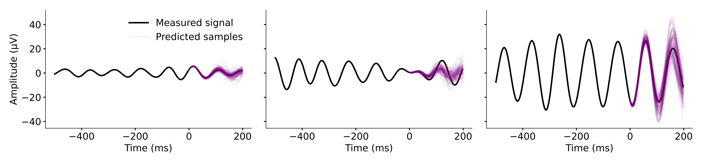

## REVBRAIN for real-time EEG forecasting &mdash; PyTorch implementation


**REVBRAIN: Real-time probabilistic EEG forecasting** (2026)<br>
Hanna Pankka¹, Jaakko Lehtinen¹², Timo Roine¹<br>
¹Aalto University, ²NVIDIA<br>
link-to-paper-here<br>


## Prerequisites
* Python package and project manager [uv](https://docs.astral.sh/uv/) installed
* Recommended: NVIDIA GPU supported by the cu128 PyTorch build, i.e. [compute capability](https://developer.nvidia.com/cuda/gpus) 7.0–12.x (e.g. V100 / T4 / RTX 20xx–50xx / A100 / H100), with driver version >=525
    * The code will run on a CPU (with the exception of the `pipeline_latency`-test), but training will be slow


## Setup
Clone the project and from the repo root, run one of the following, depending on your hardware:

```bash
uv sync --extra cu128   # PyTorch with CUDA 12.8
uv sync --extra cpu     # CPU-only PyTorch: use when your machine doesn't have a GPU that cu128 supports
```

This creates .venv/ and installs all locked dependencies. Note: do not omit the `--extra`, as a plain `uv sync` does not install PyTorch at all, and will remove it from an existing environment.


## Usage
This repository contains data processing, training, and testing scripts for three models: the RVQ-based models, REVBRAIN and TF-REVBRAIN, as well as the autoregressive model WaveNet. The following steps will guide you through the full modeling pipeline presented in the article.
* For training and testing only the WaveNet model, you can skip steps 2 and 3
* If you wish to just test inference latencies of various model configurations, go directly to step 7 "Inference latency tests"

Training and testing scripts load the data into RAM by default, but also provide a `--mmap` option to memory-map from disk. Consider setting this flag when experimenting with bigger data sets, or in case RAM is limited.

To display all available CLI options of any of the scripts, run:
```bash
uv run python script_name.py --help
```


## 1 Data preprocessing
The preprocessing step extracts the requested subjects and data conditions and applies band-pass filtering. To use the same data and apply the same preprocessing as in the article:
1. Download the dataset from the [PRED+CT repository](https://predict.cs.unm.edu/):
    * From the Download tab, choose the dataset d003 "Depression Rest" (Cavanagh et al., 2019)
    * From the directory, download the EEG recordings under the "Matlab Files"-folder and place them to a folder of your choosing
2. Run the following (replace 'path/to/EEGdata' with the folder path you chose in the previous step):
```bash
for opt in 'train' 'val' 'test'; do
    uv run python preprocess_data.py \
    path/to/EEGdata \
    data_dir \
    $opt \
    --sub_split=$opt
done
```
This uses the same train, validation, and test subject splits as in the article. The preprocessed train, validation, and test data, along with corresponding metadata, are saved to the chosen output directory data_dir as train.pt, val.pt, and test.pt.

To use a different subject split than in the article, provide a list of subject ids to process. For example, the following applies band-pass filtering for subjects 511, 517, and 531 in the theta-frequency band and saves the result in data_dir/custom_train_set.pt:
```bash
uv run python preprocess_data.py \
    path/to/EEGdata \
    data_dir \
    custom_train_set \
    511 517 531 \
    --low_freq=4.0 --high_freq=8.0
```


## 2 Create codebooks
Codebooks are needed for running the RVQ models, i.e. REVBRAIN and TF-REVBRAIN. Run the following to create the codebooks using the default parameters and the preprocessed training data created in the previous step:
```bash
uv run python create_codebooks.py data_dir/train.pt cb_dir
```
The codebooks are trained with `--n_train_samples` training examples, drawn at random from the provided training set data_dir/train.pt. The trained codebooks and their metadata as well as the training examples and errors are saved as joblib objects to cb_dir.


## 3 Prepare training targets
Training and validation targets need to be tokenized before training RVQ models. To tokenize the targets using the preprocessed data and codebooks created in the previous steps, run:
```bash
for opt in 'train' 'val'; do
    uv run python tokenize_targets.py \
        data_dir/${opt}.pt \
        cb_dir \
        ${opt}_tokenized
done
```
This saves the tokenized targets as train_tokenized.pt and val_tokenized.pt in the same data_dir as the provided preprocessed data. 


## 4 Train models
Models can be trained using train.py. Available model options are `revbrain`, `tf_revbrain` and `wavenet`. For example, to train a new REVBRAIN model with the same hyperparameters as in the article, run: 
```bash
uv run python train.py revbrain \
    data_dir/train_tokenized.pt \
    data_dir/val_tokenized.pt \
    training_runs/revbrain_run1
```
The model configuration, trained model, losses and checkpoints are saved to the run_dir. Custom hyperparameters can be passed as CLI arguments (see `--help` for all available options).

For training WaveNet, use non-tokenized preprocessed data. E.g., run the following to use the preprocessed files created in step 1, as well as custom number of epochs and hidden channels:
```bash
uv run python train.py wavenet \
    data_dir/train.pt \
    data_dir/val.pt \
    training_runs/wavenet_run1 \
    --epochs=200 \
    --n_channels=16
```

Expected training time (on an H200 GPU) and memory consumption with default training and model configurations:
* REVBRAIN: 5h, 16GB
* TF-REVBRAIN: 21h 10m, 15GB
* WaveNet: 2h 45m, 12GB


## 5 Generate predictions
Predictions can be generated with any trained model using `predict.py`. In the article, we predict 10 and 100 samples per input for testing the MAE and probabilistic phase detection accuracy, respectively. To create these, run e.g.:
```bash 
uv run python predict.py \
    training_runs/revbrain_run1 \
    data_dir/test.pt \
    --n_samples=10 \
    --output_dir=training_runs/revbrain_run1/preds10
uv run python predict.py \
    training_runs/revbrain_run1 \
    data_dir/test.pt \
    --n_samples=100 \
    --output_dir=training_runs/revbrain_run1/preds100
```
Inputs for testing are drawn at random from the provided preprocessed dataset. The inputs, ground truth continuations, and generated predictions are saved to output_dir. Finally, the script generates five prediction plots similar to the one at the top of this README (to turn off, set `--no-plot`).


## 6 Calculate metrics
We offer two different prediction performance metrics: MAE and probabilistic phase detection, as described in the article. MAE runs on any number of predicted samples, whereas the phase detection requires exactly 100 samples per input. To get metrics corresponding to those presented in the article, run:
```bash
uv run python test_metrics.py mae \
    training_runs/revbrain_run1/preds10
uv run python test_metrics.py phase_detection \
    training_runs/revbrain_run1/preds100
```
When the phase detection metric is run for the first time in a prediction_dir, the predictions and ground truths are preprocessed into phase detection 'inputs' and 'targets' and saved to the same directory; this may take several minutes. Phase detection performances at different time points can be experimented with via the `--detection_ts` option. 

The results are printed and a resulting plot is saved to the prediction_dir (to turn off plotting, set `--no-plot`).


## 7 Inference latency tests
For testing the inference latencies, we offer two testing modes:
* `trained` mode, where the inference latencies are measured with a model configuration of a trained model
* `untrained` mode, where the latencies can be measured with any set of hyperparameters (run `uv run python test_latency.py untrained --help` for all options) 

as well as two test types: 
* `inference_latency` measures the pure inference latency of the model. Use the `--n_samples` argument to control how many samples should be drawn per input.
* `pipeline_latency` measures the latency of the example modeling pipeline presented in the article

For the most reliable results, run the latency tests with the power cord on, external display unplugged, and all other applications closed.

An example of running both tests for a trained model:
```bash
uv run python test_latency.py trained \
    training_runs/revbrain_run1 \
    inference_latency pipeline_latency \
    --n_samples 1 10 100
```
This will run the pure inference latency test separately for generating 1, 10, and 100 samples per input. Results for each test are printed.

An example of running the inference latency test for a new model configuration with custom codebook arguments:
```bash
uv run python test_latency.py untrained \
    revbrain \
    inference_latency \
    --M=6 --N=1024 --no-in_relat_enc
```


## Citation
APA <br>
bibtex


## Acknowledgments
This project has received funding from:
* Jenny and Antti Wihuri Foundation
* European Research Council (ERC Synergy) under the European Union’s Horizon 2020 research and innovation programme (ConnectToBrain; grant agreement No 810377)
* European Research Council (ERC Consolidator Grant 866435)

We thank Stéphane Deny for discussions and guidance, and acknowledge the computational resources provided by the Aalto University School of Science "Science-IT" project.


## License
This project is licensed under the MIT License — see [LICENSE](LICENSE) for details.
